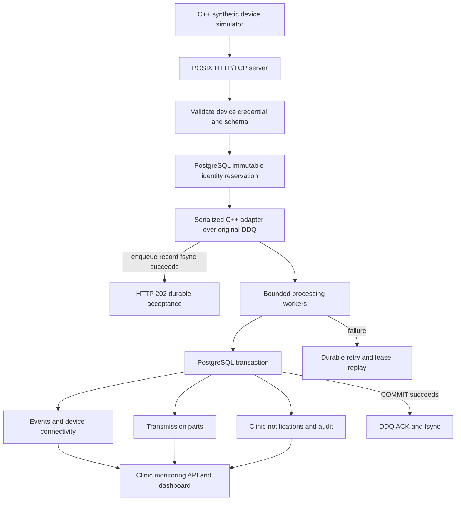

# Architecture and delivery contract

One process owns a WAL directory. Every DDQ API call, including reads and statistics, is serialized by `Queue`. Multiple processing threads claim independently through this adapter; DDQ itself remains a serialized, single-owner queue. Each bounded HTTP worker owns one cached PostgreSQL connection; processing workers also retain one each. Broken connections are replaced on subsequent requests/retries. This avoids creating a new database TCP connection for every event. A claim has a 30-second lease. PostgreSQL statement and lock timeouts are five and three seconds. Event effects are idempotent even if an unusually slow transaction exceeds a lease. Shutdown joins HTTP readers and workers, leaving unclaimed records available for restart.

An HTTP 202 means `ddq_enqueue` returned success after its record synchronization. It does not mean the worker has committed diagnostic history. HTTP 200 for a repeated event means the immutable event is already in PostgreSQL. Clients retain the exact event identity, sequence, timestamp, and payload across retries. A disconnect after enqueue is an ambiguous result; retrying the identical event is safe.

An identity reservation in PostgreSQL precedes WAL admission. It prevents conflicting pending events and reuse of a device sequence, including after restart. A reservation alone is not acceptance. If the process exits before enqueue or the queue is full, the identical event can be resubmitted; a conflicting replacement cannot. Consequently, database availability is required for new admissions. A database outage after an event has been accepted does not discard it from the queue. Duplicate pending submissions may create redundant delivery records, but the event and every derived record retain one database identity.

Workers use one PostgreSQL transaction for event insertion, connectivity high-water marks, transmission parts, notifications, and persistence audit. `ON CONFLICT` and unique constraints make replay safe. Queue ACK follows successful `COMMIT` with `synchronous_commit=on`. A crash between those operations replays the item and skips already committed effects. A queue IO/synchronization error marks the adapter failed; new admission stops and readiness fails until restart/recovery. The adapter never assumes a failed append was absent from disk.

Events retain device timestamps and sequence numbers. Out-of-order events are accepted, and history sorts by sequence. Reuse of a sequence for a different event is rejected. Connectivity uses server receipt time, not potentially delayed device clocks; the stored maximum sequence does not move backward. Heartbeats update battery percentage using a separate battery receipt clock, so a newer non-heartbeat committed by another worker cannot suppress an earlier heartbeat's battery reading. Other types do not invent battery readings. Device credentials are scoped to an immutable clinic association at registration.

Expected transmissions are configured independently at device registration, with an ID, deadline, and required part count. Every received part must match that schedule. An immutable part identity prevents two different events from claiming the same part. A query computes expected, incomplete, overdue, received, or delayed state from unique committed parts. Deadlines use server receipt time, not worker completion time. The deadline boundary is inclusive: completed at the deadline is received, after it is delayed. An incomplete submission past the deadline is overdue. Status is computed when queried; no emergency or push alert is emitted.

Diagnostic events create a notification once. `GET /v1/notifications` marks returned records as delivered to the authenticated clinic API consumer; it is deliberately a retrieval receipt. Delivery is not acknowledgment. The staff review POST requires prior delivery and preserves the first acknowledgment timestamp. Credentials identify clinics, not individual staff members. Device history, status, transmissions, notifications, acknowledgment, and audit queries include an authorized clinic predicate. Unknown and unauthorized device/notification resources return 404 to avoid exposing ownership. No credential is written into the WAL or audit subjects.

Resource bounds: eight HTTP workers, a 256-socket pending queue, four processing workers, 16 KiB request bodies, 8 KiB headers, 100-record review views, 100 schedules per registration, and 100,000 DDQ items. DDQ segments are 8 MiB with at most 64 per generation; its compaction can temporarily retain a second generation. Disk backpressure returns 503; the retrying client retains responsibility until acceptance. Idle/partial requests have socket timeouts and an overall read deadline. Connections close after each response. This is a bounded portable POSIX design; it is not a persistent-connection epoll implementation.

The tested failure model covers process exit and SIGKILL with the same WAL filesystem and durable PostgreSQL database intact. It excludes power loss, lying storage caches, simultaneous loss/restore of either store, network TLS termination, multi-node failover, and malicious database administrators. DDQ retains its own corruption and incomplete-tail handling; its original executable test suite is included in CTest. No power-cut certification, medical-device validation, or real-device compatibility is claimed.
